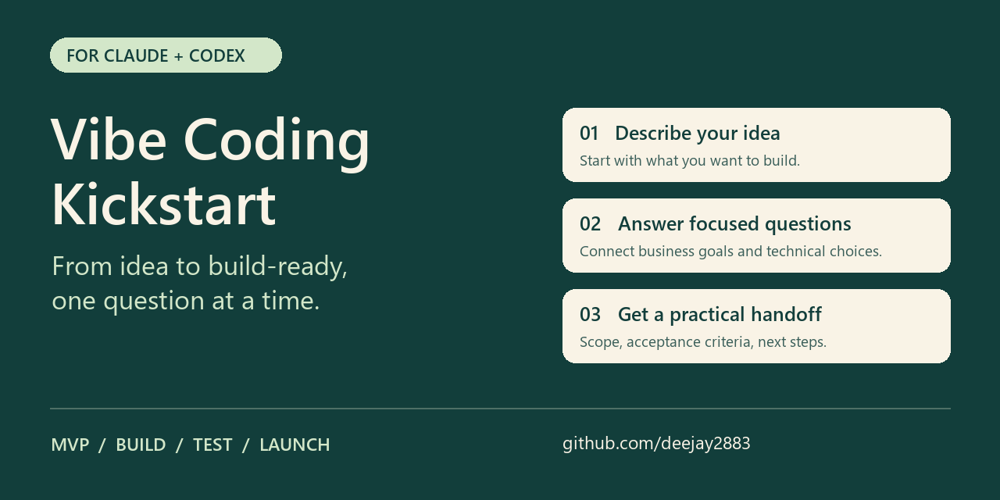

# Vibe Coding Kickstart

**From idea to build-ready, one question at a time.**

An adaptive interview skill for **Claude and Codex**. Clarify your idea, choose a useful MVP, and turn business and technical decisions into an actionable build or testing handoff.

[Download for Claude](https://github.com/deejay2883/vibe-coding-kickstart/releases/download/v1.1.0/vibe-coding-kickstart-claude.zip) | [Download Codex plugin](https://github.com/deejay2883/vibe-coding-kickstart/releases/download/v1.1.0/vibe-coding-kickstart-codex-plugin.zip) | [Quick install](#install) | [See an example](examples/booking-app.md) | [Give feedback](https://github.com/deejay2883/vibe-coding-kickstart/issues/new?template=feedback.yml)



## Start with your idea

> I want to build a booking app, but I cannot code. Ask one question at a time and help me choose an MVP.

The skill helps clarify who the product is for, what the first useful version should do, and what technical decisions matter now. It then prepares a brief or coding handoff with scope, acceptance criteria, assumptions, and the next step.

It also works on existing projects:

> We changed user permissions. Interview me about regression testing and prepare a test plan.

## Review an app you have already built

> Review my current app. Inspect the available code and UI first, ask only essential questions about ambiguity and scale, then generate a comprehensive checklist and report.

The post-build mode reviews business rules, functionality, UX/accessibility, architecture, data, access controls, integrations, performance, reliability, testing, operations, cost, and AI behavior where relevant. It adapts the checklist to your app and records evidence and gaps for every area.

The report includes an executive assessment, app/scale profile, coverage summary, detailed checklist, prioritized findings, remediation actions, and a re-test plan. Code-inspection findings, executed checks, user-reported information, and unavailable evidence stay distinct. Review requests do not automatically change the app.

[See the illustrative post-build report](examples/post-build-review.md) or [read the review workflow](skills/vibe-coding-kickstart/references/app-review.md). App access is needed for an actual inspection; otherwise the report is explicitly preliminary.

## See what you get

An illustrative example; actual responses depend on your host and project context.

| You bring | The interview explores | You leave with |
| --- | --- | --- |
| "I want to build a booking app." | First customer journey, pilot audience, data and access decisions | A bounded MVP with acceptance criteria and open decisions |
| "We changed user permissions." | Changed roles, intended baseline, and critical existing flows | A risk-ranked regression plan with expected results |

[Read the short booking-app example](examples/booking-app.md), then try the skill with your own project.

**Found it useful? Star this repository to find it again and help others discover it.** Share the question that helped, or the part that got confusing, through the [feedback form](https://github.com/deejay2883/vibe-coding-kickstart/issues/new?template=feedback.yml).

## Install

### Codex plugin

```text
codex plugin marketplace add deejay2883/vibe-coding-kickstart --ref main
codex plugin add vibe-coding-kickstart@vibe-coding-kickstart-community
```

Start a new session and ask: **Use $vibe-coding-kickstart to interview me about my project.**

This is a GitHub-backed community marketplace. See [Codex installation and directory publishing](CODEX-PUBLISHING.md) for details and official documentation. No MCP server or external service is required.

### Claude

1. Download **vibe-coding-kickstart-claude.zip** using the link above.
2. Open Claude's custom Skills interface, upload the ZIP, and enable the skill.
3. Start a conversation and ask Claude to use **Vibe Coding Kickstart** for your project.

Use the provided skill ZIP, which contains a single `vibe-coding-kickstart/` folder. GitHub's whole-repository ZIP is a different package. Availability depends on your Claude account and workspace settings. [Official Claude instructions](https://support.claude.com/en/articles/12512198-how-to-create-custom-skills).

### Claude Code

Copy `skills/vibe-coding-kickstart/` into your project's `.claude/skills/` directory:

```text
.claude/
  skills/
    vibe-coding-kickstart/
      SKILL.md
      references/
```

Start Claude Code in that project and invoke:

```text
/vibe-coding-kickstart
```

You can also describe the project interview you need in ordinary language. [Official Claude Code skills guide](https://code.claude.com/docs/en/skills).

## Keep it quick or go deeper

| Say | What happens |
| --- | --- |
| Quick | One decision at a time, focused on the next useful step |
| Guided | A few focused questions per turn; the default mode |
| Deep dive | More follow-up on consequences, alternatives, and edge cases |
| Recommend for me | A practical recommendation with its assumptions and tradeoffs |
| Skip | Defer a decision without repeatedly being asked about it |
| Handoff | Get the best current brief immediately, including open decisions |
| Pause / Resume | Get a checkpoint that you can copy into another conversation |

No command syntax is required for these controls in ordinary conversation.

## Questions change with the project

| Phase | Focus |
| --- | --- |
| Discovery | Users, problems, and a small validation experiment |
| MVP | Smallest valuable journey, exclusions, and success signal |
| Initial build | Implementation constraints, data, access, and acceptance criteria |
| Feature changes | Before/after behavior and what must keep working |
| Regression testing | Risk-ranked scenarios, expected results, and evidence gaps |
| Release | Readiness, rollout, stop conditions, and recovery |
| Maintenance / growth | Incidents, observed problems, and measurable improvements |

The skill follows the current workstream rather than forcing every project through a fixed questionnaire. A live incident gets immediate attention even if the product is still called an MVP.

## What the handoff contains

- Goal, audience, and first end-to-end slice.
- Confirmed decisions, provisional assumptions, and deferred questions.
- Relevant business rules, data, and access boundaries.
- Observable acceptance criteria, with assistant-proposed rules labeled.
- Verification steps and their actual evidence status.
- Blockers and the next concrete action.

This is an interview and planning workflow. It does not itself run tests, deploy software, or establish release readiness. Planned checks are never presented as passed tests.

## Version 1.1.0

Adds post-build app inspection, ambiguity/scale questions, and a comprehensive checklist/report workflow for both Claude and Codex. The original interview modes remain available. New-mode tabletop review results and remaining verification gates are recorded in [the review notes](evaluation/post-build-review.md).

## Validation status

The original workflow received 30 primary-assistant tabletop scenarios and iterative instruction review. Its parent package passed 11 automated structural checks and the skill frontmatter validator. Those were structural checks and self-reviewed simulations, not independent model runs or human research.

This renamed Claude package has been checked for valid frontmatter, complete references, and source-to-ZIP consistency. Native Claude installation, automatic triggering, and live conversational behavior remain unverified.

The Codex plugin passed 11 distribution checks and was installed successfully from the GitHub marketplace using Codex CLI `0.162.0-alpha.17.2`. It was reported as installed and enabled at version `1.0.0`. Real multi-turn Codex behavior and OpenAI directory acceptance remain unverified. See the [recorded installation check](CODEX-PUBLISHING.md#recorded-installation-check).

To help validate it, run the [live acceptance suite](skills/vibe-coding-kickstart/references/evaluation.md) and share an issue with your project phase, a sanitized prompt, the response, and what you expected. Do not include credentials or private customer data.

## Help improve the interview

Try one real project and tell us your host, phase, and what helped or got in your way. [Share interview feedback](https://github.com/deejay2883/vibe-coding-kickstart/issues/new?template=feedback.yml) or [report an installation problem](https://github.com/deejay2883/vibe-coding-kickstart/issues/new?template=installation.yml).

The most useful contributions are reproducible examples, clearer questions, and corrections backed by actual use. Follow the existing Review -> Test -> Compare -> Fix -> Re-Test process, and keep proposed behavior separate from observed results.

## Update the skill and plugin

The source lives in `skills/vibe-coding-kickstart/`. After editing it, rebuild and check the installation package from the repository root:

```text
python tools/build_plugin.py
python tools/test_plugin.py
```

The build uses only Python's standard library. It creates both ZIPs, the marketplace snapshot, and SHA-256 checksums. The tests check metadata, content parity, archive integrity, and paths. The original `tools/build_skill.py` also remains available for a Claude-only rebuild. Python is needed for maintaining the package, not for using the installed skill.

Use the **Review -> Test -> Compare -> Fix -> Re-Test** workflow in the evaluation reference. Retain actual outputs and document unresolved blockers.

This is a community-created workflow, not an official Anthropic or OpenAI product. GitHub publication does not list it automatically in OpenAI's plugin directory.
